<p align="center">
  
</p>

<h1 align="center">Big WM Virtual Keyboard</h1>

<p align="center">
  Teclado na tela, digitação pelo controle físico, controle na tela de toque e integração com jogos
  para o <a href="https://github.com/big-windowmaker">Big WindowMaker</a>, no visual NeXTSTEP/OPENSTEP
  do Window Maker. <b>X11</b> (Window Maker) e <b>Wayland</b> (wlmaker).
</p>

<p align="center">
  <a href="https://github.com/big-windowmaker/big-keyboard/actions/workflows/ci.yml"></a>
  
  
  
</p>

<p align="center">
  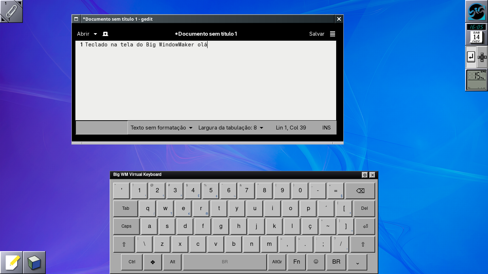
  <br><sub>Window Maker (X11): o teclado flutuante, com a moldura do Window Maker (mover, fechar,
  redimensionar), digitou “olá” (com a tecla morta ´) no gedit, que manteve o foco. À direita das teclas, os
  botões do controle na tela e das configurações. No canto, o dockapp com o LED verde do teclado aceso.</sub>
</p>

## Sumário

- [O que faz](#o-que-faz)
- [O dockapp de dois botões](#o-dockapp-de-dois-botões)
- [Teclado na tela](#teclado-na-tela)
- [Controle na tela](#controle-na-tela)
- [Jogar pelo celular: teclas, controle e mouse](#jogar-pelo-celular-teclas-controle-e-mouse)
- [Digitação pelo controle físico](#digitação-pelo-controle-físico)
- [Configurações](#configurações)
- [X11 e Wayland](#x11-e-wayland)
- [Permissões: o /dev/uinput](#permissões-o-devuinput)
- [Linha de comando](#linha-de-comando)
- [Instalar, compilar e testar](#instalar-compilar-e-testar)
- [Limites conhecidos](#limites-conhecidos)
- [Documentação, licença e créditos](#documentação-licença-e-créditos)

## O que faz

| Parte | O que é |
|---|---|
| **Teclado na tela** | ABNT2, US e US internacional, painel **Fn** e painel **☺** (símbolos e emojis); janela flutuante com a moldura do Window Maker (mover e redimensionar) ou encaixado embaixo, como no celular; pode abrir sozinho ao tocar num campo de texto; nunca rouba o foco do aplicativo |
| **Digitação pelo controle** | Xbox, DualShock/DualSense, Steam Deck e genéricos USB/Bluetooth: cursor de tecla em tecla e modo apontar dos analógicos, como no teclado do SteamOS |
| **Controle na tela** | botões e analógicos semitransparentes sobre o jogo, também em tela cheia, multitoque, com editor visual; cinco estilos (clássico, moderno, retrô, neon, minimalista), botões de Xbox, PlayStation ou Nintendo e sete modelos prontos; os jogos veem um gamepad comum (uinput) |
| **Toque remoto** | os dedos do celular (Moonlight + Sunshine) apertam o controle na tela e as teclas, e fora deles viram mouse (touchpad, clique esquerdo e direito, rolagem); usado pelo Big Remote Play |
| **Dockapp** | dois botões num ladrilho do Dock, cada um com um LED: Enter ↵ para o teclado, direcional para o controle na tela |
| **Xbox Cloud Gaming** | configura e orienta o uso do [Better xCloud](https://better-xcloud.github.io/) no navegador |
| **Tela de bloqueio** | o teclado com controle já vem no bloqueador do big-wm (gtklock no Wayland, xsecurelock no X11); a senha nunca passa por este programa |

| Ação | Como |
|---|---|
| Abrir/fechar o teclado | Enter ↵ do dockapp, `big-keyboard`, **Select + Start** no controle, ou tocar num campo de texto (se ligado) |
| Abrir/fechar o controle na tela | direcional do dockapp, ou `big-keyboard --gamepad` (`--edit-gamepad` para editar) |
| Configurações | duplo clique no dockapp, botão **Configurar** do teclado, ou `big-keyboard --settings [--page=keyboard]` |
| Trocar o teclado pelo controle na tela | botão **Controle**, à direita das teclas |
| Trocar o controle na tela pelo teclado | botão redondo com o teclado, no alto ao centro do controle |
| Mover e redimensionar o teclado | arraste o título; a barra de baixo (ou a borda da moldura) muda o tamanho |
| Soltar tudo (emergência) | menu do dockapp, ou `big-keyboard --release` |
| Controle no monitor transmitido | `big-keyboard --output=DP-1` (vazio = principal) |
| Toque do celular pelo Moonlight | **Configurações > Celular**, ou `big-keyboard --remote-touch=exclusive` (padrão), `shared` ou `off` |
| Estilo e modelo do controle na tela | **Configurações > Controle na tela** (prévia ao vivo) |

Fica residente desde o login (`big-keyboard --daemon`, autostart só no Window Maker e no wlmaker), parado
em descritores, sem gastar CPU: abrir o teclado leva cerca de 33 ms
([medições](docs/qa-2026-11-14.md#desempenho-x11-xvfb)).

## O dockapp de dois botões

`big-keyboard-dockapp` é um ladrilho de 64×64 px para o Dock ou o Clip do Window Maker (no wlmaker, pelo
XWayland). O dockapp tem 58×58 e deixa livre uma borda fina em volta: segure ali para arrastar o ladrilho. São dois botões de verdade, separados por um sulco que, como a moldura, não aciona nada.
Embaixo de cada um, um LED: verde com a janela aberta, cinza fechada. No menu Principal, ele fica em
**Configurações > Dockapps > Ferramentas > Teclado e controle na tela**.

<p align="center">
  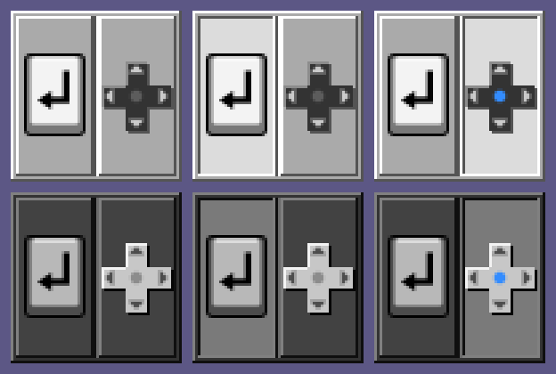
  <br><sub>Ampliado 3×, da esquerda para a direita: tudo fechado (LEDs cinza); teclado aberto (Enter
  afundado, LED verde); controle na tela aberto; os dois abertos; sem acesso ao <code>/dev/uinput</code>
  (direcional esmaecido).</sub>
</p>

| Gesto | Na tecla **Enter ↵** | No **direcional** |
|---|---|---|
| Clique | abre ou oculta o teclado | abre ou oculta o controle na tela |
| Duplo clique | abre as configurações, sem alternar nada | idem |
| Segurar além do intervalo de duplo clique | alterna ao soltar | idem |
| Botão direito | menu (abaixo) | menu |
| Parar o ponteiro | dica da metade | dica da metade |

O clique só vale depois do intervalo de duplo clique (`DoubleClickTime` do Window Maker; 250 ms sem a
chave). Apertar a outra metade dispara na hora o clique pendente, então Enter seguido do direcional abre
os dois. Soltar fora do botão ou arrastar o ladrilho não alterna nada. O centro do direcional acende com um
controle físico ligado. O desenho segue o estado do aplicativo: fechar o teclado por fora também solta o
botão.

<table>
  <tr>
    <td width="50%" align="center">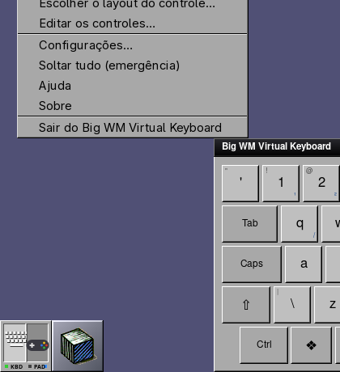<br><sub>Menu: abrir o teclado, o controle na tela ou os dois
        (híbrido), escolher e editar o layout do controle, configurações, soltar tudo, ajuda, sobre, sair.</sub></td>
    <td width="50%" align="center"><br><sub>Dica do direcional,
        com a metade em destaque (hover).</sub></td>
  </tr>
</table>

Sem acesso de escrita ao `/dev/uinput`, o direcional fica esmaecido, a dica explica o motivo e o clique só
fecha um controle já aberto (ver [Permissões](#permissões-o-devuinput)).

## Teclado na tela

- **Layouts**: ABNT2, US e US internacional (`auto` segue o `LANG`); troca pelo botão do layout ou pelo
  Select do controle.
- **Painéis**: letras, **Fn** (F1–F12, Esc, Home/End, PgUp/PgDn, Ins, Del, PrtSc, setas, mídia e brilho) e
  **☺** (símbolos e emojis).
- **Modificadores**: Shift, Ctrl, Alt, AltGr e Super valem para a próxima tecla com um toque, travam com
  dois (LED verde) e soltam no terceiro. O Caps é persistente.
- **Teclas mortas**: ´ ` ~ ^ ¨.
- **Entrada**: mouse, toque (vários dedos), controle ou teclado físico.
- **Coluna à direita das teclas**: botões grandes, um embaixo do outro: **Controle** (troca pelo controle
  na tela), **Configurar** e, no modo encaixado, **Ocultar**.
- **Janela**, em Configurações > Teclado:
  - *Flutuante* (padrão): a moldura do Window Maker, com título, fechar e barra de redimensionar. Vai para
    qualquer lugar e muda de tamanho; as teclas acompanham, com a proporção mantida. O lugar e o tamanho
    ficam gravados.
  - *Encaixado*: embaixo, na largura inteira do monitor, como no celular; pode reservar o espaço (as
    janelas sobem).
- **Abrir ao tocar num campo de texto**: como no celular, o teclado aparece quando um campo onde se digita
  ganha o foco, e pode fechar quando o foco sai dele (só se abriu sozinho). Usa a acessibilidade (AT-SPI),
  que GTK, Qt, Firefox, Chromium e LibreOffice expõem.
- **Ficar por cima**: como as outras janelas, por cima das janelas (padrão) ou por cima de tudo, até de
  jogos, vídeos e apresentações em tela cheia.
- **Foco**: o teclado nunca pega o foco do aplicativo. Tema claro, escuro ou o do Big WindowMaker.

<p align="center">
  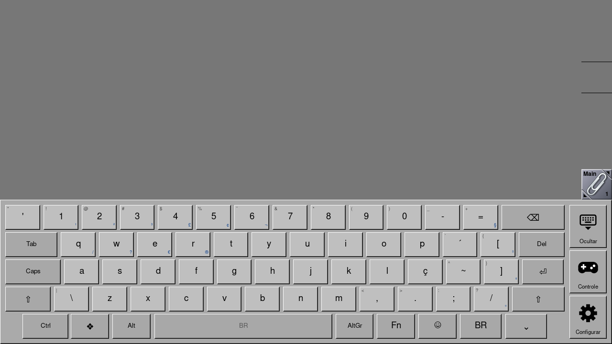
  <br><sub>Encaixado (wlmaker): a largura inteira, com Ocultar, Controle e Configurar; o espaço reservado
  sobe o Clip.</sub>
</p>

| Tema escuro, letras | Painel Fn |
|---|---|
| 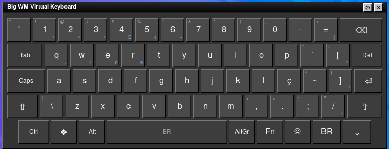 | 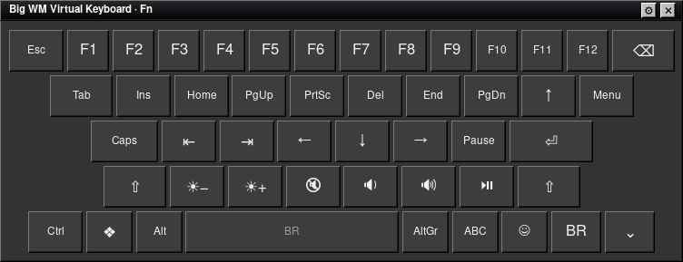 |

<p align="center">
  
  <br><sub>Com um controle físico: o cursor branco do direcional e o azul do analógico esquerdo (modo
  apontar). Captura da versão 0.1.0, antes da coluna de botões; os cursores não mudaram.</sub>
</p>

## Controle na tela

<p align="center">
  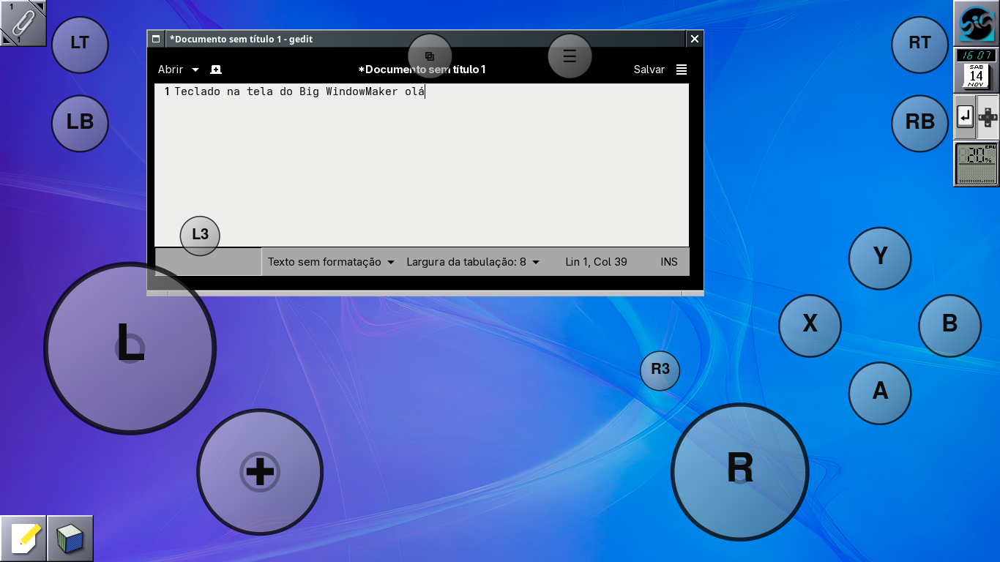
  <br><sub>Controle na tela no X11, com um compositor (picom): analógicos L e R, direcional, A B X Y,
  LB/RB, LT/RT, L3/R3, Select e Start. Sem compositor no X11, o fundo fica preto.</sub>
</p>

Ao abrir o controle na tela, o programa cria um gamepad virtual pelo uinput, que o SDL, o Steam/Proton, o
Wine e os navegadores enxergam como um controle comum (identidade genérica ou Xbox 360). Ele some quando o
controle fecha, então nada fica preso. Tem multitoque independente por dedo.

<p align="center">
  
  <br><sub>Editor (<code>big-keyboard --edit-gamepad</code>): adicionar botão, analógico ou direcional,
  remover, função, zona morta, sensibilidade, opacidade, salvar, padrão. Arraste para mover; a alça azul
  muda o tamanho.</sub>
</p>

Layouts do controle podem ser duplicados, importados e exportados em **Configurações > Controle na tela**.

### Estilos e modelos

<p align="center">
  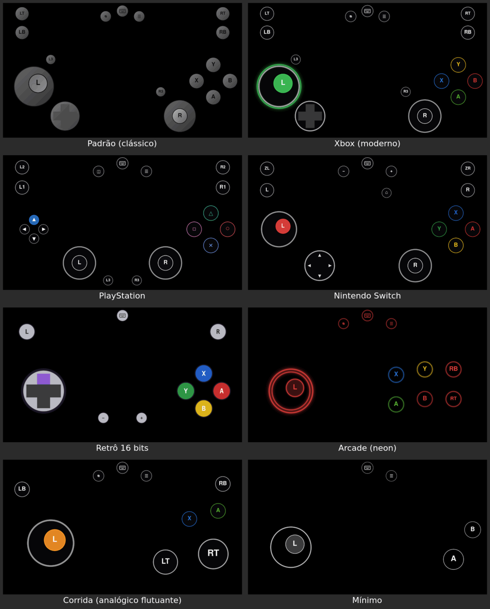
  <br><sub>Os sete modelos e o padrão, com o analógico esquerdo (ou o direcional) apertado: o pino segue o
  dedo e o direcional acende o lado apertado. Capturas no Xvfb, sem compositor (por isso o fundo preto).</sub>
</p>

A aparência é de cada layout e vai junto no arquivo dele: um layout "PlayStation" já abre com ✕ ○ □ △.

| Opção | Escolhas |
|---|---|
| Estilo | **Clássico** (relevo cinza OPENSTEP, o de sempre), **Moderno** (vidro escuro), **Retrô** (16 bits: cores fortes, contorno grosso e sombra), **Neon** (contorno luminoso), **Minimalista** (só o contorno) |
| Botões | **Xbox** (A B X Y, LB RB, LT RT), **PlayStation** (✕ ○ □ △, L1 R1, L2 R2), **Nintendo** (B A Y X, L R, ZL ZR, − + e Home), com as cores de cada um. Só os nomes e as cores mudam: o botão de baixo continua sendo o botão de baixo para o jogo |
| Cor de destaque | azul, vermelho, verde, roxo, laranja ou cinza (toques e contornos) |
| Analógico | **fixo**, ou **flutuante**: o centro vai aonde o dedo encosta |
| Direcional | **cruz**, **quatro setas** ou **disco** |
| Animação ao tocar | nenhuma, afundar, brilho, onda (um anel que se abre) ou encolher |

| Modelo | Como é |
|---|---|
| Xbox | analógico esquerdo em cima, direcional embaixo; moderno, A B X Y coloridos |
| PlayStation | direcional em cima, analógicos lado a lado embaixo; quatro setas, onda |
| Nintendo Switch | como o Pro Controller: B A Y X, L R ZL ZR, − + e Home; direcional em disco |
| Retrô 16 bits | direcional grande, quatro botões, L e R, sem analógicos |
| Arcade | alavanca e seis botões em duas fileiras, neon |
| Corrida | volante no analógico flutuante, acelerador e freio grandes |
| Mínimo | um analógico flutuante e dois botões, só o contorno |

Criar a partir de um modelo faz um layout novo (nunca sobrescreve um que já exista); depois dá para ajustar
no editor. Layouts antigos, sem aparência gravada, continuam com o visual clássico.

<p align="center">
  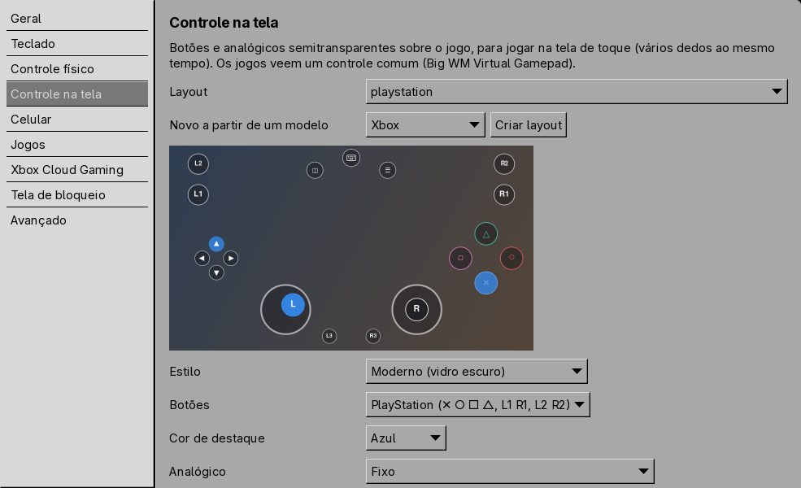
  <br><sub><b>Controle na tela</b>: o layout, um modelo para criar outro, a prévia com o mesmo desenho do
  controle e as opções de aparência do layout atual.</sub>
</p>

O controle na tela fica acima de jogos, vídeos e apresentações em tela cheia: no Wayland pela camada
OVERLAY do layer-shell (no wlmaker, a partir do pacote 38), no X11 como janela fora das camadas do
gerenciador, que volta ao topo quando ele reempilha as janelas.

## Jogar pelo celular: teclas, controle e mouse

Com um Moonlight que envia toques nativos (o oficial para Android ainda não envia; veja o Big Remote Play,
*Compartilhar → Preferências → Controles por toque*) e um Sunshine com o libvirtualhid (2026.1113 ou mais
novo), o Sunshine cria o touchscreen virtual `libvirtualhid Touchscreen`. Enquanto o teclado ou o controle na
tela estiver aberto, este programa o lê direto do kernel (sem depender do compositor; o wlmaker não entrega
toques) e cada dedo vai para o que estiver embaixo dele, vários ao mesmo tempo:

| Embaixo do dedo | O que acontece |
|---|---|
| Um botão, analógico ou gatilho do controle na tela | aperta no gamepad virtual, como na tela local |
| Uma tecla | digita; a barra de título move a janela e a de baixo muda a largura |
| Nada (com o teclado aberto) | vira **mouse** (abaixo) |
| Nada (só o controle aberto) | nada: no meio do jogo, um clique perdido atrapalha |

Sobre a janela do teclado, as teclas ganham dos controles que ficam embaixo dela.

**Mouse pelo toque** (Configurações > Celular, *Automático*):

| Aberto | Modo | Gestos |
|---|---|---|
| Só o teclado | **touchpad** | arrastar um dedo move o ponteiro; um toque rápido é o clique esquerdo onde o ponteiro estiver; parar o dedo meio segundo e então movê-lo arrasta com o botão apertado |
| Teclado e controle juntos | **toque direto** | o ponteiro vai até o dedo e clica com o botão esquerdo ali; arrastar arrasta |
| Nos dois | | com um dedo na tela, um toque com outro dedo é o **clique direito**; dois dedos juntos **rolam** |

Também dá para fixar *Sempre touchpad*, *Sempre toque direto* ou desligar, e ajustar a velocidade do touchpad.
O mouse só age no modo `exclusive` (padrão): no `shared` o compositor também receberia os dedos, e o clique
sairia dobrado. O ponteiro vem do `zwlr_virtual_pointer_v1` (Wayland, preso ao monitor transmitido) ou do
XTest (X11).

<p align="center">
  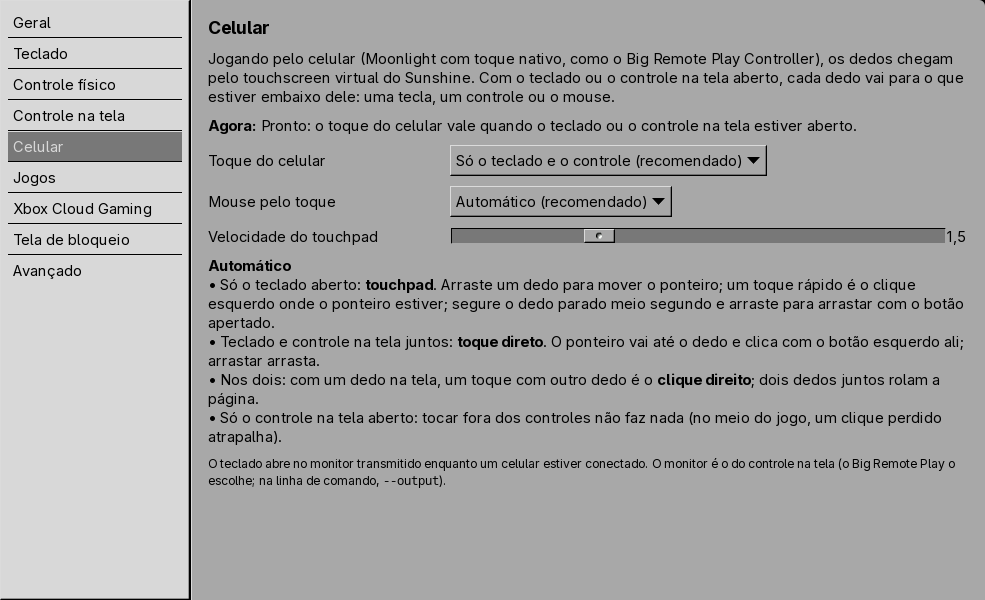
  <br><sub><b>Celular</b>: o estado em palavras (atualizado na hora), o modo do toque, o modo do mouse e a
  velocidade do touchpad.</sub>
</p>

O toque chega normalizado à imagem do monitor transmitido, então o controle fica nele (`--output`, que o Big
Remote Play escolhe), e o teclado também abre nele enquanto um celular estiver conectado. Para digitar no
meio do jogo, toque no botão redondo com o teclado (no alto, ao centro do controle); o botão **Controle**, à
direita das teclas, traz o controle de volta. A troca acontece ao tirar o dedo, e o jogo continua vendo o
mesmo gamepad: nada desconecta no meio da partida.

## Digitação pelo controle físico

O leitor de controle usa evdev e libudev, o mesmo núcleo da tela de bloqueio do big-wm. Ele aceita só os
dispositivos que o udev marca como joystick e recusa os que têm teclas de letras, então nunca lê um teclado.
**Select + Start** abre ou fecha o teclado de qualquer lugar.

| Botão | Ação |
|---|---|
| Direcional / analógico esquerdo | mover o cursor (segurar repete) |
| Analógicos (modo apontar) | o esquerdo aponta na metade esquerda (azul), o direito na direita (laranja) |
| A ✕ | apertar a tecla do cursor |
| LT / RT | apertar a tecla apontada de cada lado (sem apontar: Shift / AltGr) |
| X □ | apagar |
| Y △ | espaço |
| LB L1 | Shift |
| RB R1 | próximo painel (letras → Fn → símbolos) |
| Start | Enter |
| Select | trocar o layout |
| L3 / R3 | Caps / Tab |
| B ○ | fechar o teclado |

## Configurações

<table>
  <tr>
    <td width="50%">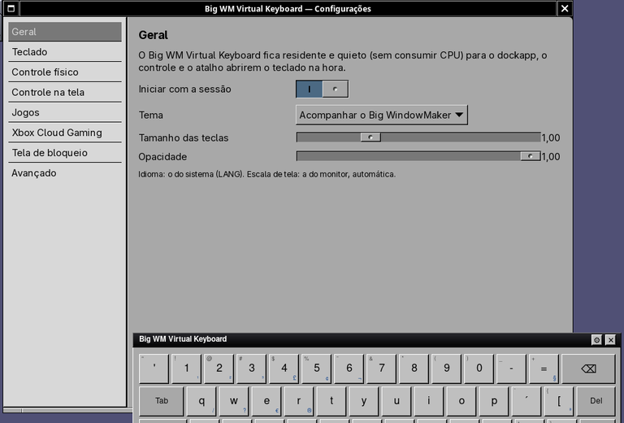</td>
    <td width="50%">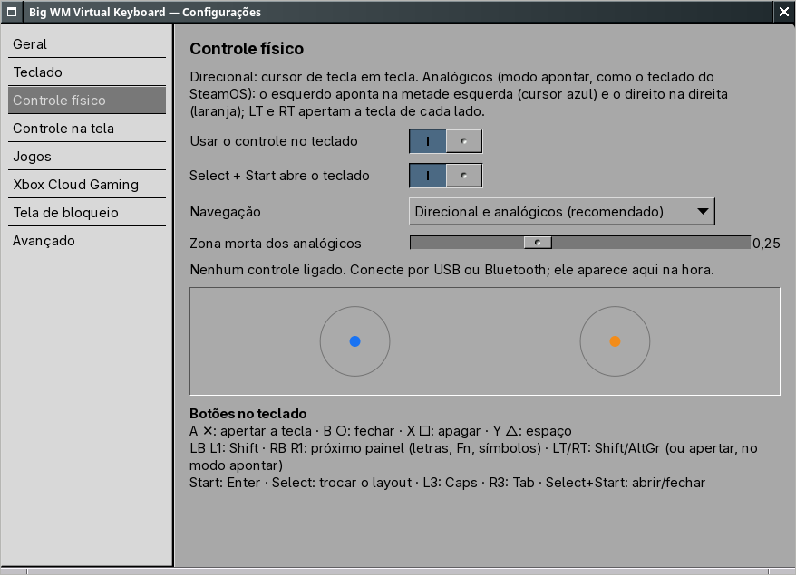</td>
  </tr>
  <tr>
    <td align="center"><sub><b>Geral</b>: iniciar com a sessão, tema, <b>modo de exibição</b>, tamanho das
    teclas e opacidade.</sub></td>
    <td align="center"><sub><b>Controle físico</b>: navegação, Select + Start, zona morta e um teste ao vivo
    dos analógicos.</sub></td>
  </tr>
</table>

Abra com duplo clique no dockapp, pelo botão **Configurar** do teclado ou com `big-keyboard --settings
[--page=SEÇÃO]`. As seções são Geral (`general`), Teclado (`keyboard`), Controle físico (`gamepad`),
Controle na tela (`overlay`), Celular (`remote`), Jogos (`games`), Xbox Cloud Gaming (`xcloud`), Tela de bloqueio (`lock`) e
Avançado (`advanced`).

**Modo de exibição** (Geral):

| Modo | Comportamento |
|---|---|
| Independente (padrão) | teclado e controle na tela abrem juntos; cada botão do dockapp cuida do seu |
| Exclusivo | abrir um oculta o outro |

**Teclado**:

<p align="center">
  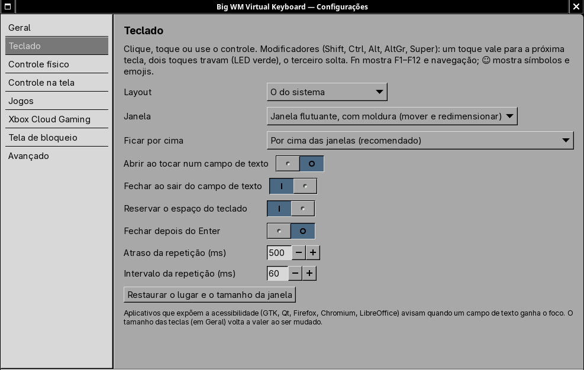
</p>

| Opção | Valores |
|---|---|
| Janela | flutuante, com moldura (padrão); encaixado embaixo, na largura da tela |
| Ficar por cima | como as outras janelas; por cima das janelas (padrão); por cima de tudo, até de tela cheia |
| Abrir ao tocar num campo de texto | desligado (padrão) |
| Fechar ao sair do campo de texto | ligado (só quando abriu sozinho) |
| Reservar o espaço do teclado | ligado (vale no modo encaixado) |
| Fechar depois do Enter, repetição | como antes |
| Restaurar o lugar e o tamanho da janela | volta para embaixo, ao centro, no tamanho das teclas |

As preferências ficam em `~/.config/big-keyboard/big-keyboard.conf` (GKeyFile versionado, gravação
atômica). Um arquivo ilegível é guardado como `.invalid` e o programa segue com os padrões.

## X11 e Wayland

<p align="center">
  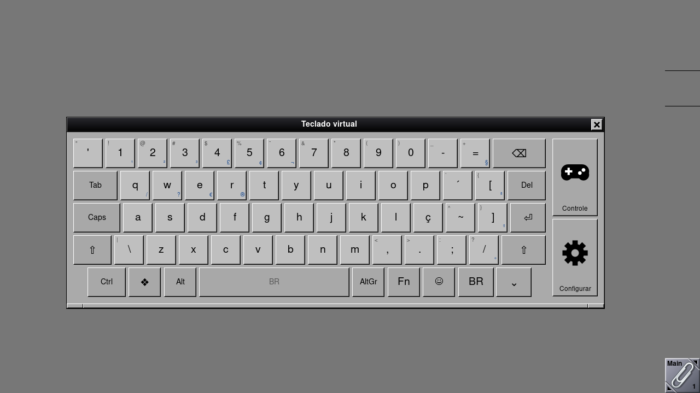
  <br><sub>wlmaker (Wayland): o teclado flutuante é uma superfície layer-shell com a moldura do Window Maker
  desenhada por ele, aqui depois de arrastado pelo título e redimensionado pela barra de baixo.</sub>
</p>

| | X11 (Window Maker) | Wayland (wlmaker) |
|---|---|---|
| Entrega das teclas | XTest, com a tecla do layout da sessão; um caractere fora dele usa um keycode livre remapeado | `zwp_virtual_keyboard_v1` com um keymap XKB gerado sob demanda: qualquer caractere Unicode, independente do layout da sessão |
| Teclado flutuante | a moldura do próprio Window Maker; a janela não aceita foco (`WM_HINTS` input=False) | layer-shell (`keyboard-interactivity none`) com a moldura desenhada no estilo Window Maker: uma janela comum ganharia o foco ao ser tocada |
| Teclado encaixado | tipo DOCK, sem foco | layer-shell ancorado embaixo, nas duas laterais |
| Por cima de tela cheia | janela override-redirect com a moldura desenhada, de volta ao topo quando o gerenciador reempilha | camada OVERLAY do layer-shell |
| Arrastar o teclado | normal | precisa do wlmaker 39 (patch 0152: a superfície mantém o ponteiro enquanto o botão está apertado, também fora dela) |
| Reservar espaço | `_NET_WM_STRUT_PARTIAL` | zona exclusiva do layer-shell |
| Controle na tela | janela override-redirect de tela inteira, acima da tela cheia, com entrada só nos botões; transparência só com compositor (picom) | camada OVERLAY do layer-shell (acima da tela cheia no wlmaker 38 ou mais novo) |
| Cliques com o controle na tela aberto | normais: sem moldura, os toques fora dos botões vão para a janela de baixo | normais |
| Dockapp | no Dock ou no Clip | pelo XWayland, no Dock do wlmaker |

Compositores Wayland sem `zwp_virtual_keyboard_v1` (o GNOME, por exemplo) não recebem as teclas.

## Permissões: o /dev/uinput

O programa roda como o usuário e **nunca como root**, e não instala nenhuma regra udev própria. Só o
**controle virtual** (controle na tela e jogos) precisa gravar no `/dev/uinput`, que fica com o usuário do
assento ativo pela tag `uaccess` de um destes pacotes:

| Pacote | Repositório |
|---|---|
| `steam-devices` | multilib |
| `game-devices-udev` | extra |

```sh
sudo pacman -S game-devices-udev   # ou steam-devices; depois, saia e entre de novo
test -w /dev/uinput && echo "uinput ok"
```

Sem esse acesso, teclado, digitação pelo controle e dockapp funcionam normalmente. Só o direcional do
dockapp fica esmaecido, e **Configurações > Jogos** mostra o estado do `/dev/uinput`. Fechar o teclado ou o
controle na tela, trocar de modo e `--release` soltam todas as teclas e botões.

## Linha de comando

```sh
big-keyboard                       # mostra ou oculta o teclado (também --toggle, --show, --hide)
big-keyboard --gamepad             # mostra ou oculta o controle na tela
big-keyboard --edit-gamepad        # editor do controle na tela
big-keyboard --hybrid              # teclado e controle juntos
big-keyboard --settings --page=gamepad
big-keyboard --release             # solta todas as teclas e botões (emergência)
big-keyboard --daemon              # inicia oculto (autostart da sessão)
big-keyboard --quit
big-keyboard-dockapp               # o ladrilho; arraste-o para o Dock ou o Clip
```

O dockapp e as chamadas seguintes falam com a instância residente pelas ações `org.gtk.Actions` do
aplicativo (`io.github.big_windowmaker.BigKeyboard`), que é a única fonte do estado (`mode`,
`pad-connected`).

## Instalar, compilar e testar

O pacote `big-keyboard` do Arch/Manjaro está em [`pkgbuild/PKGBUILD`](pkgbuild/PKGBUILD); o CI compila,
testa, empacota e roda o `namcap` a cada push (o artefato do CI é feito do commit, com o dockapp atual).

> [!NOTE]
> Sem `BIG_KEYBOARD_SOURCE`, o PKGBUILD compila a tag da versão (`v0.2.0`). Para empacotar o que está
> no `main` (ou a sua cópia local), aponte para o commit:

```sh
cd pkgbuild && BIG_KEYBOARD_SOURCE="git+file://$PWD/..#commit=$(git -C .. rev-parse HEAD)" makepkg -sif
```

O makepkg clona o repositório local: o pacote leva só o que já foi **commitado**, e o `#commit=` fixa
o commit atual, mesmo com um espelho antigo em cache, e o `-f` refaz o pacote, que mantém a mesma versão. Se antes você compilou com a fonte padrão, apague o
espelho `pkgbuild/big-keyboard/` (e `pkgbuild/src/`); senão o makepkg para com “não é um clone de”.

| Tipo | Pacotes |
|---|---|
| Depende de | glib2, gtk3, at-spi2-core, cairo, pango, libx11, libxtst, libxkbcommon, wayland, gtk-layer-shell, systemd-libs (libudev), hicolor-icon-theme, noto-fonts-emoji (os emojis do painel ☺) |
| Opcionais | steam-devices ou game-devices-udev (`/dev/uinput`), big-wm-lockscreen, big-wm-session (menu Dockapps e `big-wm-lock-settings`), xorg-xwayland (o dockapp no wlmaker), picom (transparência no X11), sunshine 2026.1113 ou mais novo (toque remoto do celular) |
| Para compilar | git, meson, wayland-protocols |

Compilar e testar sem instalar:

```sh
meson setup build
meson compile -C build
meson test -C build --print-errorlogs
```

Opções do meson: `-Dx11=` (XTest e o dockapp) e `-Dwayland=` (virtual-keyboard e layer-shell), ambas
`auto`.

`meson test` roda 8 conjuntos sem precisar de X11 nem Wayland:

| Conjunto | O que testa |
|---|---|
| `keys` | layouts, modificadores, teclas mortas e painéis |
| `geom` | geometria e toque |
| `config` | configuração, inclusive a janela do teclado (modo, por cima, lugar e tamanho) |
| `controls` | o controle na tela: toques, analógico flutuante, aparência gravada, rótulos e cores de cada família, os sete modelos (dentro da tela, sem sobreposição) |
| `touchmouse` | o mouse pelo toque: touchpad, toque direto, clique direito com dois dedos, rolagem, arrasto |
| `vpad` | o gamepad uinput; é pulado sem `/dev/uinput`, como num chroot de build |
| `dock` | o dockapp: áreas de clique, clique × duplo clique e desenho por pixels |
| `rtouch` | o toque remoto (touchscreen do Sunshine) |

Os laboratórios de X11 e Wayland e as medições estão em [docs/qa-2026-11-14.md](docs/qa-2026-11-14.md).

## Limites conhecidos

- No Wayland, a digitação usa `zwp_virtual_keyboard_v1`; compositores sem esse protocolo (o GNOME, por
  exemplo) não recebem as teclas. O GNOME também não tem layer-shell: lá o teclado e o controle na tela são
  janelas comuns, que ficam atrás da tela cheia.
- No wlmaker, arrastar o teclado flutuante pede o pacote 39 (antes dele, o ponteiro se perdia ao sair da
  superfície).
- Abrir ao tocar num campo de texto depende de o aplicativo expor a acessibilidade e do barramento AT-SPI
  da sessão; sem ele, a opção só não age (o programa não cai).
- Toque remoto: no Game Window (Big Remote Play) o celular vê só o jogo, não o controle desenhado no
  desktop; use o controle na tela do próprio Moonlight nesse modo. Touchscreens do Sunshine antigo
  (inputtino, "Touch passthrough") não são aceitos: normalizavam ao desktop inteiro.
- Ainda não existe teclado e mouse como controle para jogos **locais**; para o xCloud, o Better xCloud faz
  isso no navegador.
- A interface ainda não usa o gettext (os textos estão em português).
- Sem uma fonte de emoji (o pacote depende do `noto-fonts-emoji`), os emojis do painel ☺ aparecem como
  quadrados com o código.
- Não verificados: tela de toque real, HiDPI real, vários monitores, KDE Plasma, XFCE e Cinnamon; o mouse
  pelo toque com um celular de verdade no wlmaker (os gestos foram testados com um touchscreen simulado no
  X11).

## Documentação, licença e créditos

| Documento | Conteúdo |
|---|---|
| [docs/arquitetura.md](docs/arquitetura.md) | Escolhas, módulos, fluxo, dockapp, segurança, Xbox Cloud Gaming |
| [docs/qa-2026-11-14.md](docs/qa-2026-11-14.md) | Testes automáticos, laboratórios X11/Wayland e desempenho |
| [CHANGELOG.md](CHANGELOG.md) | Mudanças por versão |

GPL-2.0-or-later ([LICENSE](LICENSE)).

O leitor de controle (`src/input/big-wm-gamepad.c`) vem da tela de bloqueio do
[big-wm](https://github.com/big-windowmaker/big-wm). O protocolo `virtual-keyboard-unstable-v1.xml` é do
wlroots (licença MIT, no próprio arquivo). Referências de interação, sem código copiado: o teclado do
SteamOS, o [DroidDeck](https://github.com/Droid-Deck/DroidDeck) (GPL-3.0) e o
[Better xCloud](https://github.com/redphx/better-xcloud) (MIT). Xbox, Steam e SteamOS são marcas dos seus
donos; este é um projeto independente.
