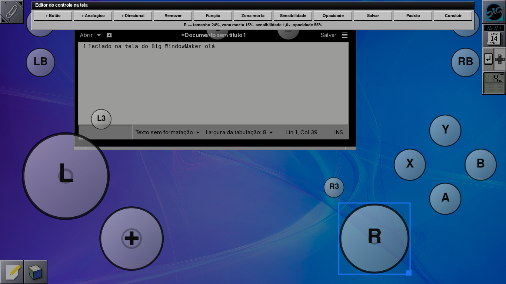

<p align="center">
  
</p>

<h1 align="center">Big WM Virtual Keyboard</h1>

<p align="center">
  Teclado na tela, digitação pelo controle físico, controle na tela de toque e integração com jogos
  para o <a href="https://github.com/big-windowmaker">Big WindowMaker</a>, no visual NeXTSTEP/OPENSTEP
  do Window Maker. <b>X11</b> (Window Maker) e <b>Wayland</b> (wlmaker).
</p>

<p align="center">
  <a href="https://github.com/big-windowmaker/big-keyboard/actions/workflows/ci.yml"></a>
  
  
  
</p>

<p align="center">
  
  <br><sub>Window Maker (X11): o teclado ABNT2 digitou “olá” (com a tecla morta ´) no gedit, que manteve o
  foco. No Dock, o dockapp de dois botões, com a tecla Enter afundada porque o teclado está aberto.</sub>
</p>

## Sumário

- [O que faz](#o-que-faz)
- [O dockapp de dois botões](#o-dockapp-de-dois-botões)
- [Teclado na tela](#teclado-na-tela)
- [Controle na tela](#controle-na-tela)
- [Digitação pelo controle físico](#digitação-pelo-controle-físico)
- [Configurações](#configurações)
- [X11 e Wayland](#x11-e-wayland)
- [Permissões: o /dev/uinput](#permissões-o-devuinput)
- [Linha de comando](#linha-de-comando)
- [Instalar, compilar e testar](#instalar-compilar-e-testar)
- [Limites conhecidos](#limites-conhecidos)
- [Documentação, licença e créditos](#documentação-licença-e-créditos)

## O que faz

| Parte | O que é |
|---|---|
| Abrir/fechar o teclado | clique no dockapp, `big-keyboard`, ou **Select + Start** no controle |
| Configurações | duplo clique no dockapp, ou `big-keyboard --settings [--page=gamepad]` |
| Controle na tela | menu do dockapp, ou `big-keyboard --gamepad` (`--edit-gamepad` para editar) |
| Trocar o teclado pelo controle na tela | botão com o controle na barra de título do teclado |
| Trocar o controle na tela pelo teclado | botão redondo com o teclado, no alto ao centro do controle |
| Soltar tudo (emergência) | menu do dockapp, ou `big-keyboard --release` |
| Controle no monitor transmitido | `big-keyboard --output=DP-1` (vazio = principal) |
| Toque do celular pelo Moonlight | `big-keyboard --remote-touch=exclusive` (padrão), `shared` ou `off` |

### Jogar pelo celular (Moonlight + Sunshine)

Com o controle na tela aberto, os dedos do celular apertam os botões dele
de verdade, vários ao mesmo tempo. Precisa de um Moonlight que envie toques
nativos (o Moonlight oficial para Android ainda não envia; veja o Big Remote
Play, *Compartilhar → Preferências → Controles por toque*) e de um Sunshine
com o libvirtualhid (2026 ou mais novo). O Sunshine cria o touchscreen
virtual `libvirtualhid Touchscreen`; este programa o lê direto do kernel
(sem depender do compositor), e no modo `exclusive` o agarra para que nada
vire clique de mouse. O controle precisa estar no monitor transmitido
(`--output`), porque o toque chega normalizado à imagem dele.

Para digitar no meio do jogo, toque no botão com o teclado (no alto, ao
centro): o controle dá lugar ao teclado no mesmo monitor, e o botão com o
controle, na barra de título do teclado, traz o controle de volta. A troca
acontece ao tirar o dedo, e o jogo continua vendo o mesmo gamepad: nada
desconecta no meio da partida.
| **Teclado na tela** | ABNT2, US e US internacional, painel **Fn** e painel **☺** (símbolos e emojis); nunca rouba o foco do aplicativo |
| **Digitação pelo controle** | Xbox, DualShock/DualSense, Steam Deck e genéricos USB/Bluetooth: cursor de tecla em tecla e modo apontar dos analógicos, como no teclado do SteamOS |
| **Controle na tela** | botões e analógicos semitransparentes sobre o jogo, multitoque, com editor visual; os jogos veem um gamepad comum (uinput) |
| **Dockapp** | dois botões num ladrilho do Dock: Enter ↵ para o teclado, direcional para o controle na tela |
| **Xbox Cloud Gaming** | configura e orienta o uso do [Better xCloud](https://better-xcloud.github.io/) no navegador |
| **Tela de bloqueio** | o teclado com controle já vem no bloqueador do big-wm (gtklock no Wayland, xsecurelock no X11); a senha nunca passa por este programa |

Fica residente desde o login (`big-keyboard --daemon`, autostart só no Window Maker e no wlmaker), parado
em descritores, sem gastar CPU: abrir o teclado leva cerca de 33 ms
([medições](docs/qa-2026-11-14.md#desempenho-x11-xvfb)).

## O dockapp de dois botões

`big-keyboard-dockapp` é um ladrilho de 64×64 px para o Dock ou o Clip do Window Maker (no wlmaker, pelo
XWayland). São dois botões de verdade, separados por um sulco que, como a moldura, não aciona nada:

<p align="center">
  
  <br><sub>Ampliado 3×, da esquerda para a direita: tudo fechado; teclado aberto (Enter afundado);
  controle na tela aberto (direcional afundado); os dois abertos; sem acesso ao <code>/dev/uinput</code>
  (direcional esmaecido).</sub>
</p>

| Gesto | Na tecla **Enter ↵** | No **direcional** |
|---|---|---|
| Clique | abre ou oculta o teclado | abre ou oculta o controle na tela |
| Duplo clique | abre as configurações, sem alternar nada | idem |
| Segurar além do intervalo de duplo clique | alterna ao soltar | idem |
| Botão direito | menu (abaixo) | menu |
| Parar o ponteiro | dica da metade | dica da metade |

O clique só vale depois do intervalo de duplo clique (`DoubleClickTime` do Window Maker; 250 ms sem a
chave). Apertar a outra metade dispara na hora o clique pendente, então Enter seguido do direcional abre
os dois. Soltar fora do botão ou arrastar o ladrilho não alterna nada. O centro do direcional acende com um
controle físico ligado. O desenho segue o estado do aplicativo: fechar o teclado por fora também solta o
botão.

<table>
  <tr>
    <td width="50%" align="center"><br><sub>Menu: abrir o teclado, o controle na tela ou os dois
        (híbrido), escolher e editar o layout do controle, configurações, soltar tudo, ajuda, sobre, sair.</sub></td>
    <td width="50%" align="center"><br><sub>Dica do direcional,
        com a metade em destaque (hover).</sub></td>
  </tr>
</table>

Sem acesso de escrita ao `/dev/uinput`, o direcional fica esmaecido, a dica explica o motivo e o clique só
fecha um controle já aberto (ver [Permissões](#permissões-o-devuinput)).

## Teclado na tela

- **Layouts**: ABNT2, US e US internacional (`auto` segue o `LANG`); troca pelo botão do layout ou pelo
  Select do controle.
- **Painéis**: letras, **Fn** (F1–F12, Esc, Home/End, PgUp/PgDn, Ins, Del, PrtSc, setas, mídia e brilho) e
  **☺** (símbolos e emojis).
- **Modificadores**: Shift, Ctrl, Alt, AltGr e Super valem para a próxima tecla com um toque, travam com
  dois (LED verde) e soltam no terceiro. O Caps é persistente.
- **Teclas mortas**: ´ ` ~ ^ ¨.
- **Entrada**: mouse, toque (vários dedos), controle ou teclado físico.
- **Foco e espaço**: o teclado não pega o foco e pode reservar o espaço na tela (as janelas maximizadas
  sobem). Tema claro, escuro ou o do Big WindowMaker.

| Tema escuro, letras | Painel Fn |
|---|---|
|  |  |

<p align="center">
  
  <br><sub>Com um controle físico: o cursor branco do direcional e o azul do analógico esquerdo (modo
  apontar). Captura da versão 0.1.0; o teclado não mudou desde então.</sub>
</p>

## Controle na tela

<p align="center">
  
  <br><sub>Controle na tela no X11, com um compositor (picom): analógicos L e R, direcional, A B X Y,
  LB/RB, LT/RT, L3/R3, Select e Start. Sem compositor no X11, o fundo fica preto.</sub>
</p>

Ao abrir o controle na tela, o programa cria um gamepad virtual pelo uinput, que o SDL, o Steam/Proton, o
Wine e os navegadores enxergam como um controle comum (identidade genérica ou Xbox 360). Ele some quando o
controle fecha, então nada fica preso. Tem multitoque independente por dedo.

<p align="center">
  
  <br><sub>Editor (<code>big-keyboard --edit-gamepad</code>): adicionar botão, analógico ou direcional,
  remover, função, zona morta, sensibilidade, opacidade, salvar, padrão. Arraste para mover; a alça azul
  muda o tamanho.</sub>
</p>

Layouts do controle podem ser duplicados, importados e exportados em **Configurações > Controle na tela**.

## Digitação pelo controle físico

O leitor de controle usa evdev e libudev, o mesmo núcleo da tela de bloqueio do big-wm. Ele aceita só os
dispositivos que o udev marca como joystick e recusa os que têm teclas de letras, então nunca lê um teclado.
**Select + Start** abre ou fecha o teclado de qualquer lugar.

| Botão | Ação |
|---|---|
| Direcional / analógico esquerdo | mover o cursor (segurar repete) |
| Analógicos (modo apontar) | o esquerdo aponta na metade esquerda (azul), o direito na direita (laranja) |
| A ✕ | apertar a tecla do cursor |
| LT / RT | apertar a tecla apontada de cada lado (sem apontar: Shift / AltGr) |
| X □ | apagar |
| Y △ | espaço |
| LB L1 | Shift |
| RB R1 | próximo painel (letras → Fn → símbolos) |
| Start | Enter |
| Select | trocar o layout |
| L3 / R3 | Caps / Tab |
| B ○ | fechar o teclado |

## Configurações

<table>
  <tr>
    <td width="50%"></td>
    <td width="50%"></td>
  </tr>
  <tr>
    <td align="center"><sub><b>Geral</b>: iniciar com a sessão, tema, <b>modo de exibição</b>, tamanho das
    teclas e opacidade.</sub></td>
    <td align="center"><sub><b>Controle físico</b>: navegação, Select + Start, zona morta e um teste ao vivo
    dos analógicos.</sub></td>
  </tr>
</table>

Abra com duplo clique no dockapp, pelo ⚙ na barra do teclado ou com `big-keyboard --settings
[--page=SEÇÃO]`. As seções são Geral (`general`), Teclado (`keyboard`), Controle físico (`gamepad`),
Controle na tela (`overlay`), Jogos (`games`), Xbox Cloud Gaming (`xcloud`), Tela de bloqueio (`lock`) e
Avançado (`advanced`).

**Modo de exibição** (Geral):

| Modo | Comportamento |
|---|---|
| Independente (padrão) | teclado e controle na tela abrem juntos; cada botão do dockapp cuida do seu |
| Exclusivo | abrir um oculta o outro |

As preferências ficam em `~/.config/big-keyboard/big-keyboard.conf` (GKeyFile versionado, gravação
atômica). Um arquivo ilegível é guardado como `.invalid` e o programa segue com os padrões.

## X11 e Wayland

<p align="center">
  
  <br><sub>wlmaker (Wayland): o mesmo teclado como superfície layer-shell, digitando “olá” no gedit; o
  dockapp fica no Dock do wlmaker, pelo XWayland.</sub>
</p>

| | X11 (Window Maker) | Wayland (wlmaker) |
|---|---|---|
| Entrega das teclas | XTest, com a tecla do layout da sessão; um caractere fora dele usa um keycode livre remapeado | `zwp_virtual_keyboard_v1` com um keymap XKB gerado sob demanda: qualquer caractere Unicode, independente do layout da sessão |
| Janela do teclado | tipo DOCK, sem foco | layer-shell, `keyboard-interactivity none` |
| Reservar espaço | `_NET_WM_STRUT_PARTIAL` | zona exclusiva do layer-shell |
| Controle na tela | janela DOCK de tela inteira, com entrada só nos botões; transparência só com compositor (picom) | camada OVERLAY do layer-shell |
| Cliques com o controle na tela aberto | precisa do **Window Maker 26** (patch 0031 em big-windowmaker/packages); no 25, o quadro da janela engole os cliques do Dock e da área de trabalho | normais |
| Dockapp | no Dock ou no Clip | pelo XWayland, no Dock do wlmaker |

Compositores Wayland sem `zwp_virtual_keyboard_v1` (o GNOME, por exemplo) não recebem as teclas.

## Permissões: o /dev/uinput

O programa roda como o usuário e **nunca como root**, e não instala nenhuma regra udev própria. Só o
**controle virtual** (controle na tela e jogos) precisa gravar no `/dev/uinput`, que fica com o usuário do
assento ativo pela tag `uaccess` de um destes pacotes:

| Pacote | Repositório |
|---|---|
| `steam-devices` | multilib |
| `game-devices-udev` | extra |

```sh
sudo pacman -S game-devices-udev   # ou steam-devices; depois, saia e entre de novo
test -w /dev/uinput && echo "uinput ok"
```

Sem esse acesso, teclado, digitação pelo controle e dockapp funcionam normalmente. Só o direcional do
dockapp fica esmaecido, e **Configurações > Jogos** mostra o estado do `/dev/uinput`. Fechar o teclado ou o
controle na tela, trocar de modo e `--release` soltam todas as teclas e botões.

## Linha de comando

```sh
big-keyboard                       # mostra ou oculta o teclado (também --toggle, --show, --hide)
big-keyboard --gamepad             # mostra ou oculta o controle na tela
big-keyboard --edit-gamepad        # editor do controle na tela
big-keyboard --hybrid              # teclado e controle juntos
big-keyboard --settings --page=gamepad
big-keyboard --release             # solta todas as teclas e botões (emergência)
big-keyboard --daemon              # inicia oculto (autostart da sessão)
big-keyboard --quit
big-keyboard-dockapp               # o ladrilho; arraste-o para o Dock ou o Clip
```

O dockapp e as chamadas seguintes falam com a instância residente pelas ações `org.gtk.Actions` do
aplicativo (`io.github.big_windowmaker.BigKeyboard`), que é a única fonte do estado (`mode`,
`pad-connected`).

## Instalar, compilar e testar

O pacote `big-keyboard` do Arch/Manjaro está em [`pkgbuild/PKGBUILD`](pkgbuild/PKGBUILD); o CI compila,
testa, empacota e roda o `namcap` a cada push (o artefato do CI é feito do commit, com o dockapp atual).

> [!NOTE]
> Sem `BIG_KEYBOARD_SOURCE`, o PKGBUILD compila a tag `v0.1.0`, que ainda tem o dockapp antigo (sem o
> módulo `bk-dock` nem os testes dele). Os estados e os cliques descritos acima vêm do `main`. Para o
> dockapp atual, empacote a cópia local:

```sh
cd pkgbuild && BIG_KEYBOARD_SOURCE="git+file://$PWD/..#commit=$(git -C .. rev-parse HEAD)" makepkg -sif
```

O makepkg clona o repositório local: o pacote leva só o que já foi **commitado**, e o `#commit=` fixa
o commit atual, mesmo com um espelho antigo em cache, e o `-f` refaz o pacote, que mantém a mesma versão. Se antes você compilou com a fonte padrão, apague o
espelho `pkgbuild/big-keyboard/` (e `pkgbuild/src/`); senão o makepkg para com “não é um clone de”.

| Tipo | Pacotes |
|---|---|
| Depende de | glib2, gtk3, at-spi2-core, cairo, pango, libx11, libxtst, libxkbcommon, wayland, gtk-layer-shell, systemd-libs (libudev), hicolor-icon-theme |
| Opcionais | steam-devices ou game-devices-udev (`/dev/uinput`), big-wm-lockscreen, big-wm-session (`big-wm-lock-settings`), picom (transparência no X11) |
| Para compilar | git, meson |

Compilar e testar sem instalar:

```sh
meson setup build
meson compile -C build
meson test -C build --print-errorlogs
```

Opções do meson: `-Dx11=` (XTest e o dockapp) e `-Dwayland=` (virtual-keyboard e layer-shell), ambas
`auto`.

`meson test` roda 6 conjuntos sem precisar de X11 nem Wayland:

| Conjunto | O que testa |
|---|---|
| `keys` | layouts, modificadores, teclas mortas e painéis |
| `geom` | geometria e toque |
| `config` | configuração |
| `controls` | o controle na tela |
| `vpad` | o gamepad uinput; é pulado sem `/dev/uinput`, como num chroot de build |
| `dock` | o dockapp: áreas de clique, clique × duplo clique e desenho por pixels |

Os laboratórios de X11 e Wayland e as medições estão em [docs/qa-2026-11-14.md](docs/qa-2026-11-14.md).

## Limites conhecidos

- No Wayland, a digitação usa `zwp_virtual_keyboard_v1`; compositores sem
  esse protocolo (o GNOME, por exemplo) não recebem as teclas.
- O controle na tela fica acima de janelas em tela cheia só onde o
  compositor permite (camada OVERLAY do layer-shell; no X11, uma janela
  DOCK acima, com transparência só com um compositor como o picom).
- Toque remoto: no Game Window (Big Remote Play) o celular vê só o jogo,
  não o controle desenhado no desktop; use o controle na tela do próprio
  Moonlight nesse modo. Touchscreens do Sunshine antigo (inputtino, "Touch
  passthrough") não são aceitos: normalizavam ao desktop inteiro.
- Teclado e mouse como controle para jogos **locais** ainda não existe; para
  o xCloud, o Better xCloud faz isso no navegador.
- A tradução da interface ainda não está no gettext (textos em português).
- No Wayland, compositores sem `zwp_virtual_keyboard_v1` não recebem as teclas.
- O controle na tela fica acima de janelas em tela cheia só onde o compositor permite (camada OVERLAY no
  Wayland; janela DOCK acima no X11).
- No X11, cliques com o controle na tela aberto precisam do Window Maker 26.
- Ainda não existe teclado e mouse como controle para jogos **locais**; para o xCloud, o Better xCloud faz
  isso no navegador.
- A interface ainda não usa o gettext (os textos estão em português).
- Não verificados: tela de toque real, HiDPI real e vários monitores.

## Documentação, licença e créditos

| Documento | Conteúdo |
|---|---|
| [docs/arquitetura.md](docs/arquitetura.md) | Escolhas, módulos, fluxo, dockapp, segurança, Xbox Cloud Gaming |
| [docs/qa-2026-11-14.md](docs/qa-2026-11-14.md) | Testes automáticos, laboratórios X11/Wayland e desempenho |
| [CHANGELOG.md](CHANGELOG.md) | Mudanças por versão |

GPL-2.0-or-later ([LICENSE](LICENSE)).

O leitor de controle (`src/input/big-wm-gamepad.c`) vem da tela de bloqueio do
[big-wm](https://github.com/big-windowmaker/big-wm). O protocolo `virtual-keyboard-unstable-v1.xml` é do
wlroots (licença MIT, no próprio arquivo). Referências de interação, sem código copiado: o teclado do
SteamOS, o [DroidDeck](https://github.com/Droid-Deck/DroidDeck) (GPL-3.0) e o
[Better xCloud](https://github.com/redphx/better-xcloud) (MIT). Xbox, Steam e SteamOS são marcas dos seus
donos; este é um projeto independente.
