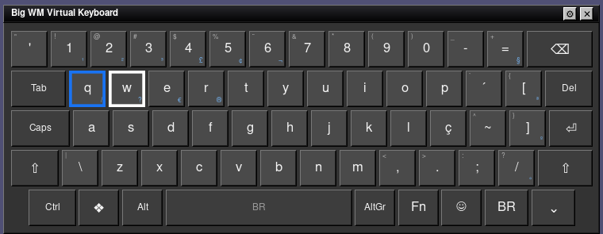

# Big WM Virtual Keyboard

Teclado na tela, digitação pelo controle físico, controle na tela de toque e
integração com jogos para o [Big WindowMaker](https://github.com/big-windowmaker),
no visual NeXTSTEP/OPENSTEP do Window Maker. X11 (Window Maker) e Wayland
(wlmaker).


| | |
|---|---|
|  |  |
|  |  |

## O que faz

- **Teclado na tela**: ABNT2, US e US internacional; painel **Fn** (F1–F12,
  Home/End, PgUp/PgDn, Ins, Del, setas, mídia) e painel **☺** (símbolos e
  emojis). Shift, Ctrl, Alt, AltGr e Super: um toque vale para a próxima
  tecla, dois travam (LED verde), o terceiro solta; Caps persistente; teclas
  mortas (´ ` ~ ^ ¨). Mouse, toque (vários dedos), controle ou teclado físico.
  Nunca rouba o foco do aplicativo e pode reservar o espaço (as janelas sobem).
- **Digitação pelo controle** (Xbox, DualShock/DualSense, Steam Deck,
  genéricos USB/Bluetooth): direcional move um cursor de tecla em tecla; os
  analógicos apontam cada um numa metade do teclado, como os trackpads do
  teclado do SteamOS, e os gatilhos apertam.
- **Controle na tela**: botões e analógicos semitransparentes sobre o jogo,
  multitoque, com editor visual; os jogos veem um gamepad comum (uinput).
- **Dockapp** metade teclado, metade controle: clique abre/fecha, duplo
  clique abre as configurações, botão direito traz o menu.
- **Xbox Cloud Gaming**: configura e orienta o uso do
  [Better xCloud](https://better-xcloud.github.io/) (teclado e mouse como
  controle no navegador), sem uma segunda emulação concorrente.
- **Tela de bloqueio**: o teclado com controle já vem no bloqueador do
  big-wm (gtklock no Wayland, xsecurelock no X11), com o mesmo leitor de
  controle; a senha nunca passa por este programa.

## Usar

| Ação | Como |
|---|---|
| Abrir/fechar o teclado | clique no dockapp, `big-keyboard`, ou **Select + Start** no controle |
| Configurações | duplo clique no dockapp, ou `big-keyboard --settings [--page=gamepad]` |
| Controle na tela | menu do dockapp, ou `big-keyboard --gamepad` (`--edit-gamepad` para editar) |
| Trocar o teclado pelo controle na tela | botão com o controle na barra de título do teclado |
| Trocar o controle na tela pelo teclado | botão redondo com o teclado, no alto ao centro do controle |
| Soltar tudo (emergência) | menu do dockapp, ou `big-keyboard --release` |
| Controle no monitor transmitido | `big-keyboard --output=DP-1` (vazio = principal) |
| Toque do celular pelo Moonlight | `big-keyboard --remote-touch=exclusive` (padrão), `shared` ou `off` |

### Jogar pelo celular (Moonlight + Sunshine)

Com o controle na tela aberto, os dedos do celular apertam os botões dele
de verdade, vários ao mesmo tempo. Precisa de um Moonlight que envie toques
nativos (o Moonlight oficial para Android ainda não envia; veja o Big Remote
Play, *Compartilhar → Preferências → Controles por toque*) e de um Sunshine
com o libvirtualhid (2026 ou mais novo). O Sunshine cria o touchscreen
virtual `libvirtualhid Touchscreen`; este programa o lê direto do kernel
(sem depender do compositor), e no modo `exclusive` o agarra para que nada
vire clique de mouse. O controle precisa estar no monitor transmitido
(`--output`), porque o toque chega normalizado à imagem dele.

Para digitar no meio do jogo, toque no botão com o teclado (no alto, ao
centro): o controle dá lugar ao teclado no mesmo monitor, e o botão com o
controle, na barra de título do teclado, traz o controle de volta. A troca
acontece ao tirar o dedo, e o jogo continua vendo o mesmo gamepad: nada
desconecta no meio da partida.

O dockapp: `big-keyboard-dockapp` (arraste o ícone para o Dock ou o Clip).

### Controle no teclado

| Botão | Ação |
|---|---|
| Direcional / analógico esquerdo | mover o cursor (segurar repete) |
| Analógicos (modo apontar) | o esquerdo aponta na metade esquerda (azul), o direito na direita (laranja) |
| A ✕ | apertar a tecla do cursor |
| LT / RT | apertar a tecla apontada de cada lado (sem apontar: Shift / AltGr) |
| X □ | apagar |
| Y △ | espaço |
| LB L1 | Shift |
| RB R1 | próximo painel (letras → Fn → símbolos) |
| Start | Enter |
| Select | trocar o layout |
| L3 / R3 | Caps / Tab |
| B ○ | fechar o teclado |

## Instalar

Pacote `big-keyboard` (Arch/Manjaro): `pkgbuild/PKGBUILD`. Para a cópia local:

```sh
cd pkgbuild && BIG_KEYBOARD_SOURCE="git+file://$PWD/.." makepkg -si
```

Compilar e testar sem instalar:

```sh
meson setup build && meson compile -C build && meson test -C build
```

Dependências: GTK 3, gtk-layer-shell, libxkbcommon, libX11/libXtst,
libwayland-client, libudev. O controle virtual precisa de acesso ao
`/dev/uinput` (regra `uaccess` do `steam-devices` ou `game-devices-udev`);
o programa nunca roda como root.

## Limites conhecidos

- No Wayland, a digitação usa `zwp_virtual_keyboard_v1`; compositores sem
  esse protocolo (o GNOME, por exemplo) não recebem as teclas.
- O controle na tela fica acima de janelas em tela cheia só onde o
  compositor permite (camada OVERLAY do layer-shell; no X11, uma janela
  DOCK acima, com transparência só com um compositor como o picom).
- Toque remoto: no Game Window (Big Remote Play) o celular vê só o jogo,
  não o controle desenhado no desktop; use o controle na tela do próprio
  Moonlight nesse modo. Touchscreens do Sunshine antigo (inputtino, "Touch
  passthrough") não são aceitos: normalizavam ao desktop inteiro.
- Teclado e mouse como controle para jogos **locais** ainda não existe; para
  o xCloud, o Better xCloud faz isso no navegador.
- A tradução da interface ainda não está no gettext (textos em português).

Detalhes: [docs/arquitetura.md](docs/arquitetura.md) e o relatório de testes
[docs/qa-2026-11-14.md](docs/qa-2026-11-14.md).

## Licença e créditos

GPL-2.0-or-later. O leitor de controle (`src/input/big-wm-gamepad.c`) vem da
tela de bloqueio do [big-wm](https://github.com/big-windowmaker/big-wm). O
protocolo `virtual-keyboard-unstable-v1.xml` é do wlroots (licença MIT, no
próprio arquivo). Referências de interação, sem código copiado: o teclado do
SteamOS, o [DroidDeck](https://github.com/Droid-Deck/DroidDeck) (GPL-3.0) e o
[Better xCloud](https://github.com/redphx/better-xcloud) (MIT). Xbox, Steam e
SteamOS são marcas dos seus donos; este é um projeto independente.
